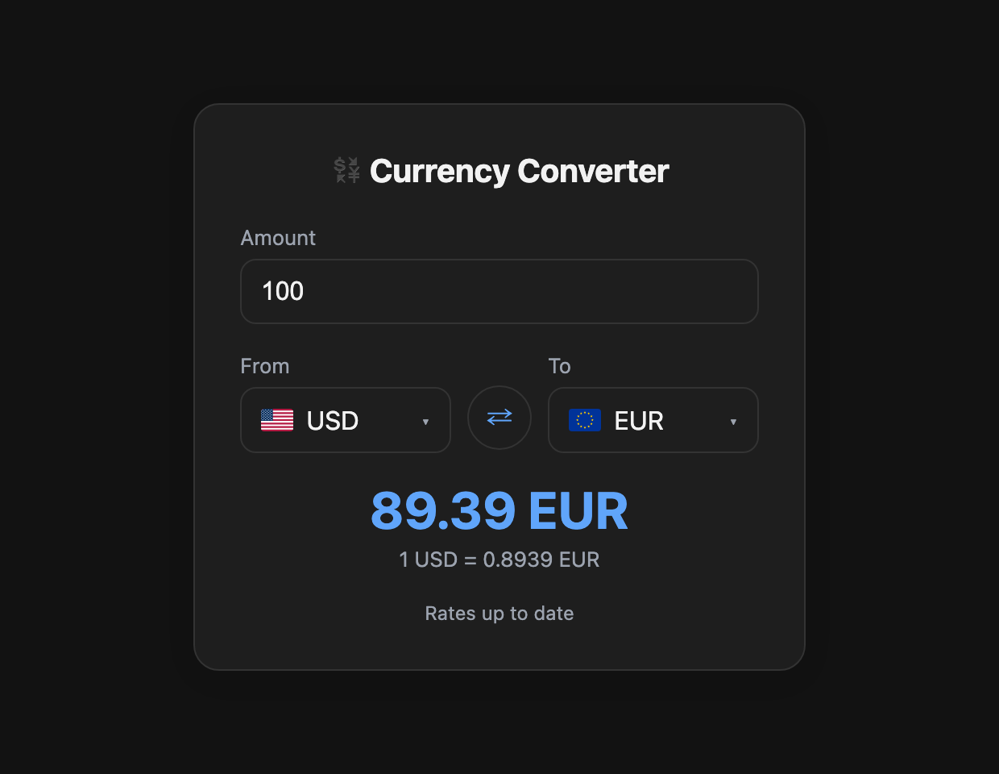

# Currency Converter

[](https://github.com/kvark85/currency-converter/actions/workflows/deploy.yml)


A fast, **offline-first currency converter** built as a **Progressive Web App (PWA)**. Install it on Android, iOS or desktop like a regular app, and it keeps working without an internet connection.

**[Live demo → kvark85.github.io/currency-converter](https://kvark85.github.io/currency-converter/)**

<p align="center">
  
</p>

## Features

- **Works offline.** The app shell is cached by a service worker, and the last known exchange rates are persisted locally, so conversions keep working on a plane, in the metro or abroad without roaming.
- **Installable on Android, iOS and desktop.** Open the demo in Chrome and tap *Install app*; on iOS the same button shows the installation steps. It launches from the home screen in its own window, like a native app.
- **Live rates with graceful fallback.** Fresh rates come from the network, with fallback to cached rates and then to built-in approximate rates. The status line always shows which source is in use.
- **Remembers your choice.** Amount, selected currencies and recently used currencies survive reloads and app restarts.
- **Recently used currencies** are pinned to the top of each dropdown.
- **Two-way input:** type into either row and the other one is calculated.
- **Light and dark themes** that follow the system setting.
- **Country flags** and full names in the currency list, and a one-tap **swap** button.
- **13 currencies:** USD, EUR, GBP, PLN, CHF, JPY, CNY, UAH, KZT, GEL, TRY, AED, RUB.
- Accepts both `,` and `.` as the decimal separator. The result is rounded to 2 decimals, while the unit rate keeps more precision.

## Install on your phone

**Android (Chrome):**
1. Open [kvark85.github.io/currency-converter](https://kvark85.github.io/currency-converter/).
2. Tap the **Install app** button under the converter (or the **⋮** menu → **Install app**).
3. Launch it from the home screen. It now works without internet too.

**iOS (Safari):** tap **Install app** for instructions, or go straight to **Share** → **Add to Home Screen**.

**Desktop (Chrome / Edge):** click the install icon in the address bar.

## How offline mode works

| Layer | Tool | What it does |
| --- | --- | --- |
| App shell | Workbox service worker (`vite-plugin-pwa`) | Precaches HTML, JS, CSS, icons and flags, so the app opens with no network |
| Rates API | Workbox `NetworkFirst` runtime cache | Tries the network with a 4s timeout, then serves the last cached API response |
| Server state | TanStack Query + `localStorage` persister | Keeps the last fetched rates across full reloads; refetches at most hourly |
| Client state | Zustand + `persist` | Saves amount, selected and recently used currencies |
| Last resort | Built-in approximate rates | Used on a very first launch with no connection at all |

Server state (exchange rates) and client state (user selection) are kept separate on purpose: each has its own cache, lifetime and persistence.

## Tech stack

- [React 19](https://react.dev/) + [TypeScript 5](https://www.typescriptlang.org/) + [Vite 6](https://vite.dev/)
- [vite-plugin-pwa](https://vite-pwa-org.netlify.app/) (Workbox): web app manifest, service worker, offline caching
- [TanStack Query](https://tanstack.com/query) with a persisted query client: server state
- [Zustand](https://zustand.docs.pmnd.rs/) with `persist`: client state
- CSS Modules
- [Vitest](https://vitest.dev/) unit tests
- ESLint with typescript-eslint and react-hooks rules
- GitHub Actions → GitHub Pages: lint, test, build and deploy on every push to `main`

## Project structure

Feature-sliced layout: the app layer only wires things together, and all converter logic lives in one self-contained feature.

```
src/
  app/                        App bootstrapping
    providers/QueryProvider   Persisted TanStack Query client
    styles/                   Global styles
  features/currency-converter/
    api/                      Rates API client + offline fallback rates
    model/                    Zustand store, rates query, conversion hook
    lib/                      Pure logic: conversion, rates status, currency order, formatting
    ui/                       Presentational components (CSS Modules)
    index.ts                  Public API of the feature
  features/install-app/       "Install app" button: native prompt or iOS instructions
```

## Getting started

```bash
npm install
npm run dev
```

| Command | Description |
| --- | --- |
| `npm run dev` | Start the dev server (the service worker is enabled in dev too) |
| `npm run build` | Type-check and build for production, generating the service worker |
| `npm run preview` | Preview the production build at `http://localhost:4173/currency-converter/` |
| `npm test` | Run unit tests once (`npm run test:watch` for watch mode) |
| `npm run lint` | Run ESLint |
| `npm run typecheck` | Run the TypeScript compiler without emitting files |

To try offline mode locally, run `npm run build && npm run preview`, open the app once, then switch DevTools → Network to **Offline** and reload.

## Tests

Business logic is kept in pure functions and a store, so it is tested without rendering the UI:

- **Conversion:** cross-currency math through USD, decimal comma input, invalid input, missing rates
- **Rates status:** loading, live, cached and offline-fallback states
- **Currency order in dropdowns:** current value first, recently used next, no duplicates
- **Store:** swap, recently used currencies (limit 4), persistence to `localStorage`, and safe restore that ignores unknown currencies
- **API client:** successful response, HTTP errors and unexpected response shape (with mocked `fetch`)
- **Formatting:** rounding money and keeping precision for small rates

## Deployment

Every push to `main` triggers [`.github/workflows/deploy.yml`](.github/workflows/deploy.yml). It installs dependencies, runs lint and tests, builds the app and publishes `dist/` to GitHub Pages. The Vite `base` is set to `/currency-converter/` to match the project-site URL.

## Data source

Exchange rates come from [open.er-api.com](https://www.exchangerate-api.com/docs/free), a free API that needs no key. Rates are relative to USD and refresh at most once an hour.
